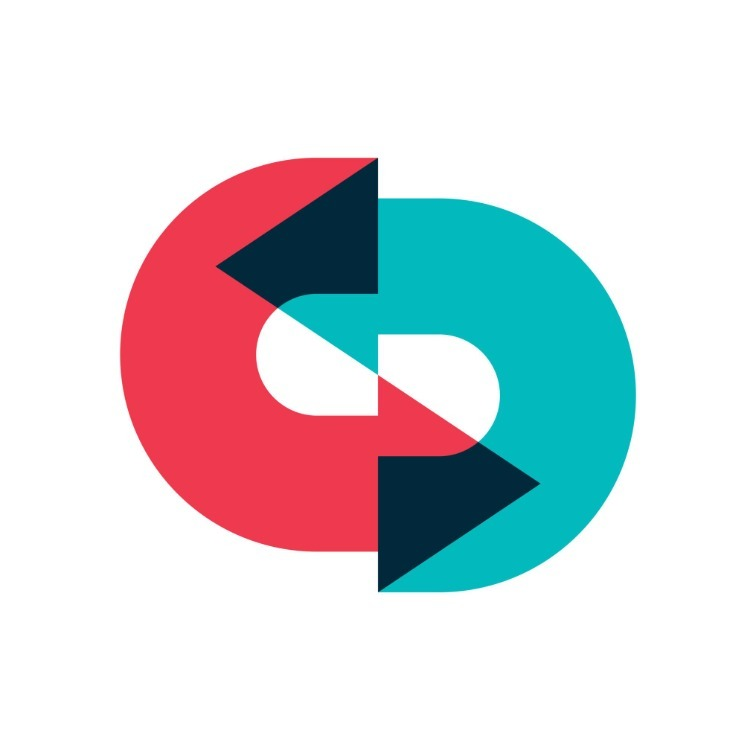

# SkillSwap

<div align="center">



### **A Reciprocal Peer-to-Peer Skill Exchange Platform**

*Trade knowledge directly with passionate peers. Teach what you love, learn what you desire — 100% free, barter-powered learning.*

[](https://nextjs.org/)
[](https://reactjs.org/)
[](https://www.typescriptlang.org/)
[](https://tailwindcss.com/)
[](https://supabase.com/)
[](LICENSE)

[Features](#-key-features) • [Reciprocal Algorithm](#-smart-reciprocal-matching-algorithm) • [Architecture](#-project-architecture) • [Getting Started](#-getting-started) • [Database Setup](#-supabase-database-schema) • [Contributing](#-contributing)

</div>

---

## 📖 Overview

**SkillSwap** is a modern collaborative web application designed to democratize learning through direct peer-to-peer exchanges. Instead of paying hefty course fees or subscriptions, community members teach subjects they are experienced in (e.g., UI/UX Design, React, Digital Marketing) in exchange for personalized instruction in skills they want to acquire (e.g., Python, Video Editing, Music Production).

Built using **Next.js 14**, **React 18**, **TypeScript**, **Tailwind CSS**, and **Supabase**, SkillSwap provides a seamless authenticated platform featuring real-time reciprocal matching, comprehensive profile management, full session lifecycles with reschedule negotiation, verifiable peer ratings, and an in-app notification center.

---

## ✨ Key Features

### 🎯 Smart Reciprocal Matching
- **Automated Two-Way Compatibility**: Calculates compatibility scores (up to 99%) by analyzing overlap between your teaching roster and other members' learning wishlists.
- **Mutual Value Proposition**: Immediately highlights complementary exchange pairs (e.g., *"You teach React, they teach Figma"*).
- **Filtering & Search**: Filter members by domain categories (*Engineering, Design, Marketing, Media, Languages, Music*), keyword, rating, and availability.

### 👤 Rich Member Profiles & Skill Rosters
- **Teach Skills**: Categorized skills with proficiency levels (*Beginner, Intermediate, Advanced, Expert*), years of experience, and custom descriptions.
- **Learn Wishlist**: Skills you want to learn with urgency priorities (*High, Medium, Low*), current proficiency, and specific learning milestones.
- **Availability Schedule**: Detailed weekly time slots and preferred days.
- **Custom Privacy**: Toggle profile visibility between `public`, `members_only`, and `paused`.

### 📅 End-to-End Session Lifecycle Management
- **1:1 Session Proposals**: Book sessions directly from match cards with customized dates, time slots, formats (*Online Meet or In-Person*), and session goals.
- **Multi-State Scheduling**: Track requests through statuses: `pending`, `confirmed`, `rescheduled`, `completed`, `declined`, and `cancelled`.
- **Counter-Proposal & Reschedule Engine**: Propose alternate times with attached notes; maintains an audit trail of scheduling negotiations.

### ⭐ Trust, Verification & Mutual Reviews
- **Verified Post-Session Reviews**: Only participants of completed sessions can submit ratings (1-5 stars) and detailed testimonials.
- **Automated Reputation Score**: Profiles automatically update cumulative rating averages and swapped hour totals upon review submission.

### 🔔 Real-Time Notification Center
- Instant alerts for session requests, confirmation responses, reschedule proposals, and received reviews.
- Unread counter badges and one-click "mark as read" capability.

### 🌓 Adaptive Light & Dark Mode
- Built-in theme context supporting system preference detection and manual toggle.
- Custom aesthetic color palette with CSS variables (*Blush Pink, Electric Lime, Peach, Lavender*).

---

## 🧮 Smart Reciprocal Matching Algorithm

The matching engine dynamically scores compatibility between members:

| Match Category | Condition | Compatibility Score | Explanation |
| :--- | :--- | :---: | :--- |
| **Direct 2-Way Match** | User teaches what Peer wants to learn **AND** Peer teaches what User wants to learn | **95% – 99%** | Perfect reciprocal exchange opportunity |
| **Wishlist Match** | Peer teaches a skill on User's learning wishlist | **84%** | High single-direction match |
| **Mentor Match** | User can teach a skill Peer wants to learn | **80%** | Valuable mentoring opportunity |
| **General Affinity** | Complementary domain categories | **65%** | Cross-domain networking potential |

---

## 🛠️ Tech Stack

- **Framework**: [Next.js 14](https://nextjs.org/) (App Router with Client & Server components)
- **Frontend Library**: [React 18](https://react.dev/)
- **Language**: [TypeScript](https://www.typescriptlang.org/)
- **Styling**: [Tailwind CSS 3](https://tailwindcss.com/) with custom CSS design tokens
- **Icons**: [Lucide React](https://lucide.dev/)
- **Backend & Database**: [Supabase](https://supabase.com/)
  - **PostgreSQL**: Relational database with Foreign Key cascades
  - **Supabase Auth**: Secure email & password authentication and session management
  - **Row Level Security (RLS)**: Enforced data isolation and member access controls
- **Avatars**: [DiceBear API](https://www.dicebear.com/) fallback generation
- **Hosting / Deployment**: [Vercel](https://vercel.com/)

---

## 📂 Project Architecture

```plaintext
skillSwap/
├── app/
│   ├── globals.css            # Global CSS variables & Tailwind directives
│   ├── layout.tsx             # Root Next.js layout & metadata
│   ├── page.tsx               # Next.js entry page
│   └── skillswap-app.tsx      # Application context wrappers (Theme, Auth, Notif)
├── lib/
│   └── supabase.ts            # Supabase client initialization
├── public/
│   └── logo.png               # Brand icon & logo
├── src/
│   ├── App.tsx                # Client-side router & authenticated workspace layout
│   ├── components/
│   │   ├── layout/            # Navbar, Footer, AppHeader, AppSidebar
│   │   ├── matches/           # MatchCard, CompatibilityBadge, RequestSessionModal
│   │   ├── profile/           # SkillModal, SkillTag
│   │   ├── sessions/          # SessionCard, SessionDetailModal, ReviewModal
│   │   └── ui/                # Button, Card, Badge, Modal, Input, ThemeToggle
│   ├── context/
│   │   ├── AuthContext.tsx    # Supabase session & user lifecycle state
│   │   ├── NotificationContext.tsx # In-app notification state & counts
│   │   └── ThemeContext.tsx   # Light/dark mode controller & local storage sync
│   ├── services/
│   │   └── api.ts             # 100% native Supabase CRUD service & matching logic
│   └── views/
│       ├── DashboardPage.tsx  # User overview, quick metrics, pending actions
│       ├── FindMatchesPage.tsx# Reciprocal match directory with search & filters
│       ├── LandingPage.tsx    # Public landing page & interactive exchange simulator
│       ├── LoginPage.tsx      # Supabase authentication login
│       ├── MemberProfilePage.tsx # Public view of peer profiles & reviews
│       ├── MyProfilePage.tsx  # Skill roster, bio, availability & privacy editor
│       ├── NotificationsPage.tsx # In-app alert history
│       ├── SessionsPage.tsx   # Upcoming, pending, and past session dashboard
│       └── SignupPage.tsx     # Onboarding form with initial skill selection
├── .env.example               # Template environment variables
├── next.config.mjs            # Next.js build configuration
├── tailwind.config.js         # Theme color definitions & utility extensions
├── tsconfig.json              # TypeScript compilation rules
└── vercel.json                # Vercel deployment routes
```

---

## 🚀 Getting Started

### Prerequisites

- **Node.js**: `v18.17.0` or later
- **npm**, **pnpm**, or **yarn**
- A **Supabase** account (Free tier works perfectly)

### 1. Clone the Repository

```bash
git clone https://github.com/your-username/skillswap.git
cd skillswap
```

### 2. Install Dependencies

```bash
npm install
```

### 3. Setup Environment Variables

Copy the sample environment file to create `.env`:

```bash
cp .env.example .env
```

Open `.env` and fill in your Supabase project credentials:

```env
NEXT_PUBLIC_SUPABASE_URL=https://YOUR_PROJECT_ID.supabase.co
NEXT_PUBLIC_SUPABASE_ANON_KEY=YOUR_SUPABASE_ANON_KEY
```

---

## 🗄️ Supabase Database Schema

---

## 🏃 Running the Application

### Development Server

Run the development server locally:

```bash
npm run dev
```

Open [http://localhost:3000](http://localhost:3000) in your browser to explore SkillSwap.

### Type Check & Build

Validate TypeScript types and compile for production:

```bash
# Typecheck
npm run lint

# Production build
npm run build

# Start production server
npm run start
```

---

## 🚀 Deployment

The easiest way to deploy this application is using the [Vercel Platform](https://vercel.com/):

1. Push your repository to GitHub / GitLab.
2. Import your repository into Vercel.
3. Configure the environment variables (`NEXT_PUBLIC_SUPABASE_URL` and `NEXT_PUBLIC_SUPABASE_ANON_KEY`).
4. Click **Deploy**.

---

## 🗺️ Product Roadmap

- [ ] **Live WebRTC In-App Video & Audio Rooms**: Built-in 1:1 video conferencing with screen share.
- [ ] **Real-Time Direct Messaging**: Chat threads between exchange partners prior to booking.
- [ ] **Skill Badges & Quizzes**: Automated skill assessments to verify instructor proficiency.
- [ ] **Calendar Integration**: Export session invites directly to Google Calendar and Outlook (`.ics`).
- [ ] **Community Group Workshops**: Multi-participant group exchange sessions.

---

## 🤝 Contributing

Contributions, feedback, and pull requests are welcome!

1. Fork the Project
2. Create your Feature Branch (`git checkout -b feature/AmazingFeature`)
3. Commit your Changes (`git commit -m 'Add some AmazingFeature'`)
4. Push to the Branch (`git push origin feature/AmazingFeature`)
5. Open a Pull Request

---

## 📄 License

Distributed under the **MIT License**. See `LICENSE` for more information.

---

<div align="center">
  <sub>Built with ❤️ for lifelong learners everywhere.</sub>
</div>
